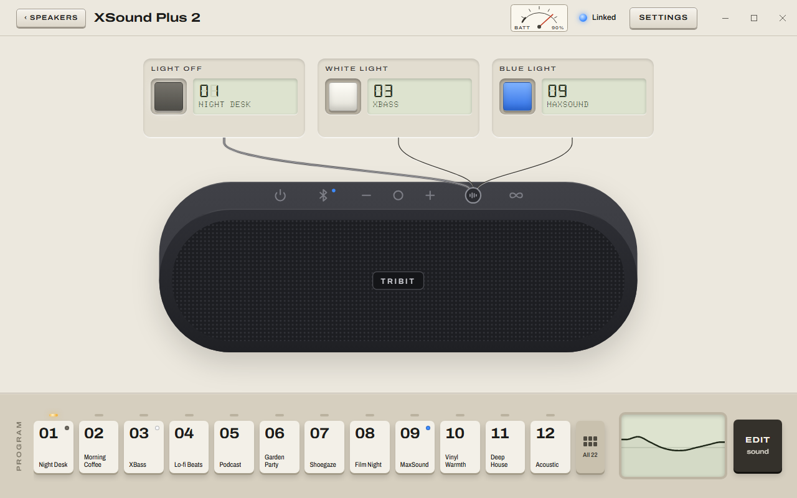
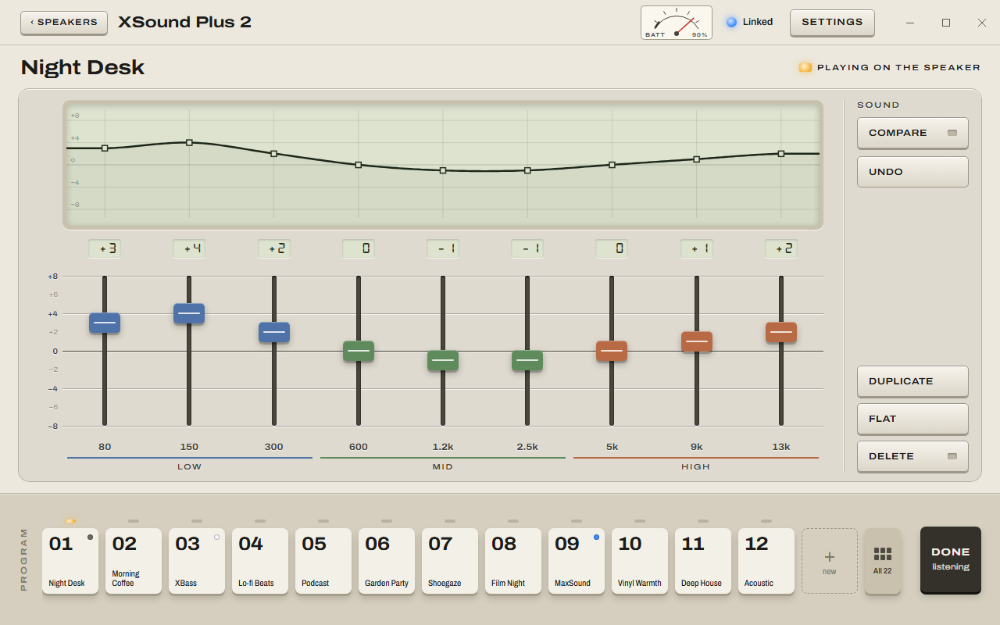
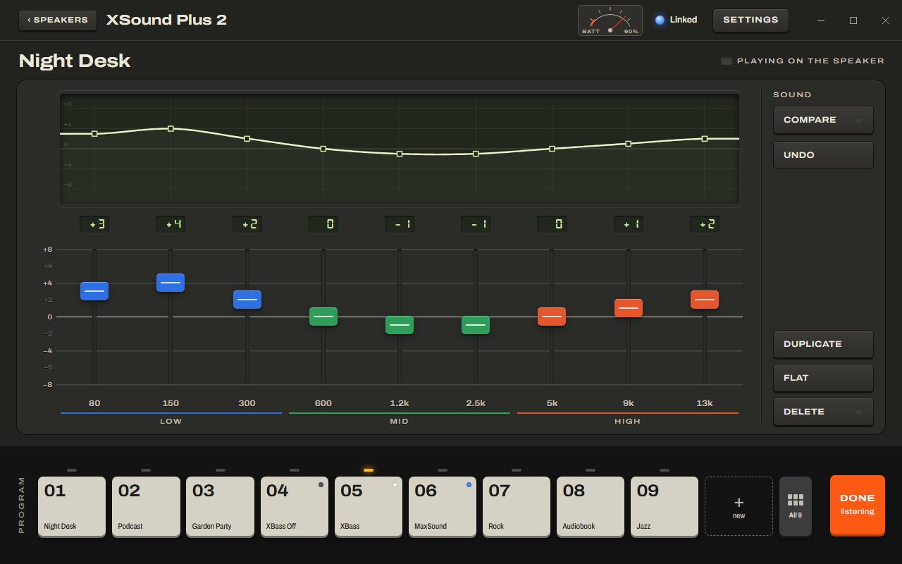
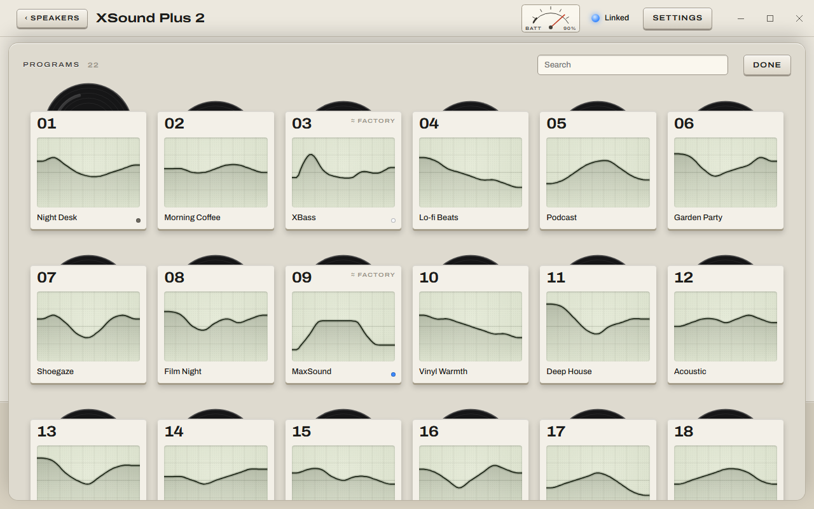
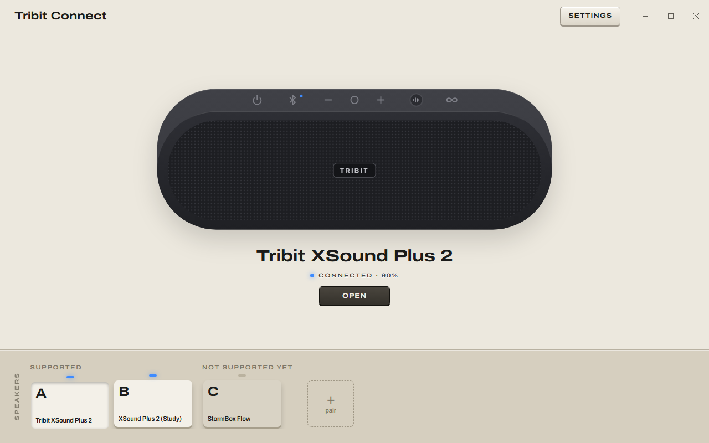

# Tribit Connect

**The Tribit XSound Plus 2, at home on Windows.** Tribit Connect brings your speaker's sound,
battery and settings to the PC it plays from. You don't need to reach for your phone, and nothing goes
through an account or the cloud. Shape the sound with a nine-band EQ that the speaker plays as you draw it.
Put your best curves on the speaker's own EQ button. Switch programs from the Windows widget or the tray.

It is designed like a piece of studio hardware: ivory keys, backlit displays and lamps that glow when
something is on. Everything it shows is something the speaker has confirmed.



An independent project, not affiliated with Tribit or Microsoft. MIT licensed.

## What it does

**Shape the sound**
- **A live EQ editor.** Nine bands from 80 Hz to 13 kHz, ±8 dB, as faders or drawn straight onto the
  display. The speaker plays what you see as you move it. Every change is kept as you make it, so there
  is no Save button.
- **Compare and Undo.** Compare plays the program as it was, with its curve dashed on the display, until you
  press it again. Undo goes back one step at a time.
- **Programs.** Your own curves and the six factory presets live in one list, in the order you choose.
  Editing a factory preset makes a copy you can change.
  - **+ new** starts flat and **Duplicate** copies the program you're on.
  - **Delete** takes two presses: the first arms it with a red lamp, the second deletes, and Undo is offered after.

**Use it every day**
- **The program bar.** Your first twelve programs are keys along the bottom of the window. Press one to play
  it, drag one to reorder.
- **All programs.** Every program on one page, as records with their curves on the sleeves and search at the
  top. The one playing lifts its disc and turns while music plays.
  - Drag to rearrange.
  - Right-click to edit, duplicate or delete.
- **The speaker's EQ button.** The button cycles through three lights: off, white and blue. Choose what each
  light plays, including your own curves. The speaker keeps them through a power cycle.
- **Widget and tray.** A Win + W widget and the tray icon's menu show the battery and your first six programs,
  so you can switch without opening the app.
- **Several speakers.** The Speakers page lists your paired Tribit speakers. Each one keeps its last-known
  settings, so switching back shows them right away.
- **Speaker settings.** Voice prompt beeps and auto shutdown.

**Feels like hardware**
- **Light and dark.** Light is ivory with backlit displays and an ink accent; dark is graphite with
  green-on-black displays and orange. It follows Windows, or you can choose.
- **Calm, consistent motion.** Pages step back together and come in from top to bottom. The window opens
  only once the page has drawn, so it never flashes.
- **A visualizer.** When this PC plays through the speaker, faint spectrum bars run behind the curve. It only
  hears this PC, not your phone.
- **Close to tray, Start with Windows, and updates** from this repository's releases.

Every change counts only once the speaker reports it back. **Not supported**, because their commands are
unknown: renaming the speaker, the shutdown countdown, power off, factory reset and firmware updates. Use the
Tribit app for those.

| | |
|---|---|
|  |  |
| The EQ editor | The same, in dark |
|  |  |
| All programs, as records | The Speakers page |

## Install

1. Download **`TribitConnect-Setup.exe`** from
   [Releases](https://github.com/KanuTomer/tribit-connect/releases) and run it.
2. Choose **Yes** when Windows asks for permission. Setup does three things:
   - it trusts the app's certificate;
   - it installs the Windows App Runtime from Microsoft if it is missing;
   - it installs the app.
3. Pair the speaker in Windows Bluetooth settings. Open **Tribit Connect** from Start, or add
   **XSound Plus 2** from Win + W > Add widgets.

The app isn't signed by a recognised publisher yet, so SmartScreen may say "Windows protected your PC".
Choose **More info**, then **Run anyway**. To uninstall it, go to Settings > Apps.

Requires Windows 11 x64 with Widgets (the Windows Web Experience Pack) and WebView2, both included
with Windows 11.

<details><summary>Manual install, without setup</summary>

1. Download `TribitConnect_<version>.msix` and `TribitConnect.Local.cer` from the same release.
2. In an administrator PowerShell in the download folder, run
   `Import-Certificate -FilePath TribitConnect.Local.cer -CertStoreLocation Cert:\LocalMachine\TrustedPeople`.
3. Install Microsoft.WindowsAppRuntime.2 2.5.1 or newer if it is missing, then open the `.msix` and
   select **Install**.
</details>

## Using it

**Speakers page.** The app opens on the speaker you used last. It opens on the Speakers page instead in two cases:
- that speaker is off;
- you have two or more speakers and haven't picked one.

It goes to the speaker by itself once Windows connects it. **‹ Speakers** in the title bar takes you to the
Speakers page at any time. To go back, choose the speaker and **Open** (or press Enter, or double-click it).
It opens on the speaker's home page.

**The editor.** **EDIT** opens it for the program that is playing, and **DONE** or Esc returns to the
speaker. A program beyond the first twelve can still be edited; while you edit it, it sits on the bar as an
extra key in a faded colour.

**One controller at a time.** The speaker accepts a single control connection. While Tribit Connect holds it,
the Tribit app on your phone can't connect.
- **To free it for the phone:** turn on **Let the phone app connect** in that speaker's settings. The speaker
  is then released shortly after you close the app and the widget.
- **If the phone app holds it instead:** Tribit Connect says **Controls busy** and offers **Try again**.

**Settings** follow the page:

| Where | What Settings holds |
|---|---|
| A speaker's page | that speaker's beeps, auto shutdown and Let the phone app connect |
| The Speakers page | the app's appearance, widget, window, updates and help (**App settings ›** in a speaker's Settings goes there) |

**The widget.** Windows shows a widget from an app outside the Microsoft Store only while Developer Mode
is on. Settings on the Speakers page shows whether it is on. It also opens the right Windows page and tells
you how to add the widget. Without the widget, the tray icon's menu has the same six buttons.

**Close to tray.** Closing the window keeps the app in the notification area. Click the icon to bring it back.
Right-click it for a menu:
- the speaker and its battery;
- the widget's six buttons (pick one to play it without opening the app);
- **Open** and **Quit**.

About 15 seconds after the window is hidden, the app lets go of the speaker. That way the phone app can
connect while Tribit Connect sits in the tray.

**Start with Windows.** The app starts in the tray when you sign in, so the widget is ready. Windows controls
this switch: if it won't stay on, allow Tribit Connect in Windows Settings > Apps > Startup.

**Updates.** The app looks for updates once a day while **Check for updates** is on, or when you press
**Check now**. It asks this repository's releases whether there is a newer version; nothing about you or your
PC is sent. When you choose **Update to x.y.z**, it downloads the new setup and checks two things: its SHA-256
matches, and it is signed by this project's certificate. It then updates in place, keeping your profiles, and
reopens the app. Versions 0.6.0 and earlier can't update themselves; install the latest release once by hand.

## Your data

Profiles and settings are stored in `%LOCALAPPDATA%\Tribit Connect`:

| File | Contents |
|---|---|
| `profiles.json` | your profiles and the order of your programs |
| `profiles.bak` | your profiles as they were when the app last started, in case a save goes wrong |
| `profiles.bad-<time>.json` | a profiles file the app could not read, kept instead of being replaced |
| `state.json` | the speaker in use, the last values read from each speaker, and the app's settings |
| `theme` | light or dark, so the window opens in the right colour |
| `WebView2\` | the app window's browser cache (safe to delete) |
| `diagnostics.log` | only while Diagnostic log is on |

Uninstalling keeps this folder, so reinstalling or updating never loses your profiles. Windows doesn't let
packaged apps run anything on uninstall. To remove your data, use **Settings > Remove my data** before you
uninstall, or delete the folder afterwards. Profiles from 0.3.0 and earlier move here on first launch.

## Develop

You need Windows x64 with Developer Mode, the Visual Studio 2022 C++ Build Tools with CMake, the Windows
SDK, and Node.js.

```powershell
./scripts/build.ps1 -Check                                      # fetch NuGet packages, build, run native tests
node --test app/tests/model.test.js app/tests/style.test.js    # frontend model and stylesheet tests
./scripts/package.ps1                                           # signed MSIX, certificate and setup in out/
./scripts/package.ps1 -Register                                 # or register the build in place for development
```

`package.ps1` also writes `TribitConnect-Setup-<version>.exe` and its `.sha256`. A release must carry
both for the updater to offer it.

- **The app** is plain HTML, CSS and JavaScript in [app/](app/), hosted in WebView2 by
  [src/webview_host.hpp](src/webview_host.hpp).
  - Open `app/index.html` in a browser to work on it against a simulated speaker. Press the backtick key for
    the simulator's controls.
  - Query options set up other states, such as `?offline`, `?speakers=two`, `?uptodate`, `?music` and
    `?scene=compare`. They are listed in [app/js/mock-backend.js](app/js/mock-backend.js).
  - `?smoke` runs a scripted pass over the main flows.
- **The host** is [src/app.cpp](src/app.cpp): the speaker link ([src/controller.hpp](src/controller.hpp)),
  the widget provider, the tray, and the updater ([src/updates.hpp](src/updates.hpp)).
- **Widget** cards come from [src/widget_card.hpp](src/widget_card.hpp). `./scripts/mock.ps1` renders
  every card into `build/mock/index.html` with the Adaptive Cards renderer.
- **Design rules** are in [docs/DESIGN.md](docs/DESIGN.md). Every colour and every duration is a token
  there; `style.test.js` keeps them out of the rules.

## Protocol

The speaker is controlled over Bluetooth Classic, on RFCOMM channel 3, with a small checksummed frame format.
It was decoded from an Android HCI snoop capture of the Tribit app and confirmed from Windows. See
[PROTOCOL.md](PROTOCOL.md). The scrubbed capture is in [captures/](captures/), so you can check the
decoding or continue it.

Own a different Tribit speaker? [Add your speaker](https://tribit-connect-submit.vercel.app/) walks you
through recording a capture and sends it, cleaned in your browser.

## Probe

`tribit-probe` reads and writes the protocol from the command line. Close the Tribit app and Tribit
Connect first, because the speaker accepts one control connection at a time.

```powershell
./scripts/build.ps1 -Check
./build/bin/Release/tribit-probe.exe
```

By default it is read-only and prints JSON. It never scans, pairs or retries. It reads:
- battery, firmware and the current EQ;
- voice prompts and the EQ button's lights;
- the unidentified status values.

Options:
- `--trace` prints every frame sent and received.
- `--listen SECONDS` records frames the speaker sends by itself, for example when its buttons are pressed.
- `--verify-voice-prompts` flips TWS Pairing Beep once, confirms it, then restores it.
- These three write and don't restore the previous value:
  - `--preset 0-5` applies an EQ preset.
  - `--custom-eq DB,...` applies nine custom bands.
  - `--button-slot LIGHT=PRESET|custom:DB,...` sets what a light selects.
