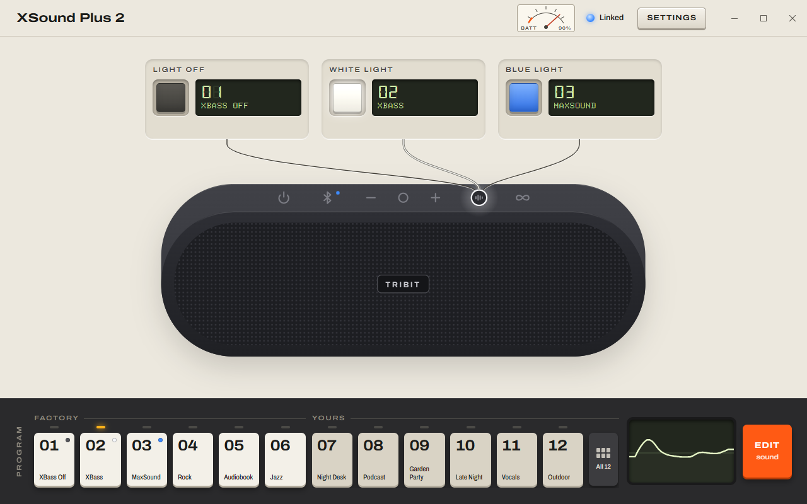
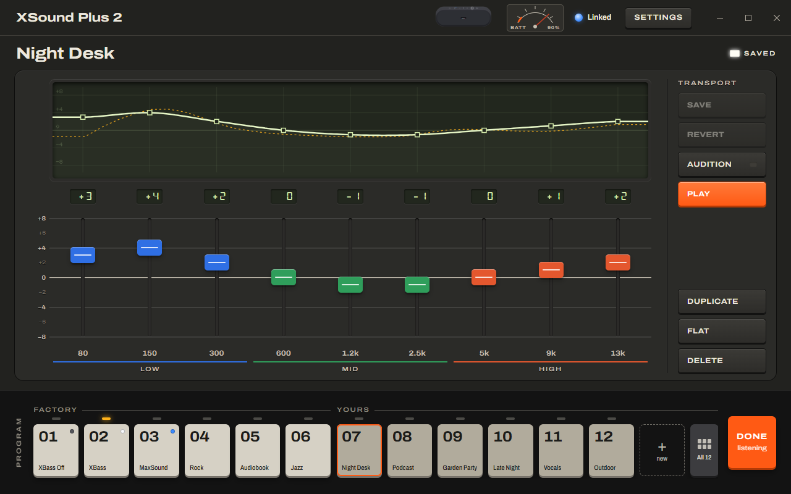

# Tribit Connect

Windows controls for the Tribit XSound Plus 2 speaker: a Win + W widget and a companion app,
**Sound Lab**, with a custom EQ editor. Modelled on
[Sound Connect](https://github.com/KanuTomer/Sound-Connect). Independent project; not affiliated
with Tribit or Microsoft. MIT licensed.



## What it does

- **Programs.** Play the six factory EQ presets, or your own profiles, from the app or the widget.
- **Custom EQ.** Nine-band editor (80 Hz to 13 kHz, ±8 dB) with faders and a drawable display.
  Profiles are saved on this PC; unsaved drafts are kept automatically until you save or revert.
  **Audition** plays the curve on the speaker while you move the faders.
- **Library.** A drawer of all your profiles, shown as records, with search. The first six are
  the ones on the program bank: drag a record into that row to put it there. Right-click a record
  to edit, duplicate or delete it.
- **The EQ button's lights.** The speaker's EQ button cycles through three lights (off, white,
  blue). Choose what each light plays, including your own curves; the speaker keeps them, even
  after a power cycle.
- **Widget.** Battery, connection and six program buttons. Any button can hold one of your
  profiles (Settings → Windows).
- **Speaker settings.** Voice prompt beeps and auto shutdown.
- **Light and dark** appearance, or follow Windows.
- **Visualizer.** When this PC plays through the speaker, faint spectrum bars run behind the curve
  in the program display. It only sees audio from this PC, not from your phone.
- Every change counts only once the speaker reports it back.

Not supported, because their commands are unknown: renaming the speaker, the shutdown countdown,
power off, factory reset and firmware updates. Use the Tribit app for those.

The speaker accepts one control connection at a time. While Tribit Connect holds it, the Tribit
app on your phone cannot connect; turn on **Let the phone app connect** in Settings, or close the
app and widget first.



## Install

1. Download **`TribitConnect-Setup.exe`** from
   [Releases](https://github.com/KanuTomer/tribit-connect/releases) and run it.
2. Choose **Yes** when Windows asks for permission. Setup trusts the app's publisher certificate,
   installs the Windows App Runtime from Microsoft if it is missing, and installs the app.
3. Pair the speaker in Windows Bluetooth settings. Open **Tribit Connect** from Start, or add
   **XSound Plus 2** from Win + W > Add widgets.

**Updating:** download the newer `TribitConnect-Setup.exe` and run it; it updates the app in place
and keeps your profiles. Profiles from 0.3.0 and earlier move to the new data folder (below) on first
launch.

The app is not yet signed by a recognised publisher, so Windows SmartScreen may say "Windows
protected your PC" when setup starts: choose **More info**, then **Run anyway**. Uninstall it from
Settings > Apps like any other app.

Requires Windows 11 x64 with the Windows Web Experience Pack (Widgets) and WebView2, both included
with Windows 11.

<details><summary>Manual install, without setup</summary>

1. Download `TribitConnect_<version>.msix` and `TribitConnect.Local.cer` from the same release.
2. Open an administrator PowerShell in the download folder and run
   `Import-Certificate -FilePath TribitConnect.Local.cer -CertStoreLocation Cert:\LocalMachine\TrustedPeople`.
3. Install Microsoft.WindowsAppRuntime.2 2.5.1 or newer if it is missing, then open the `.msix`
   and select **Install**.
</details>

## Your data

Profiles, light assignments, widget buttons and settings are stored in
`%LOCALAPPDATA%\Tribit Connect` (for example `C:\Users\<you>\AppData\Local\Tribit Connect`):

| File | Contents |
|---|---|
| `profiles.json` | your saved profiles, drafts, their order, and the widget buttons |
| `state.json` | the last values read from the speaker, and app settings |
| `theme` | light or dark, so the window opens in the right colour |
| `WebView2\` | the app window's browser cache (safe to delete) |
| `diagnostics.log` | only when Diagnostic log is turned on |

Uninstalling Tribit Connect keeps this folder, so reinstalling or updating never loses your
profiles. Windows does not let packaged apps run anything when they are uninstalled, so there is
no question at that point. To remove your data, use **Settings > Remove my data** in the app before
uninstalling, or delete the folder afterwards.

## Develop

Requirements: Windows x64, Developer Mode, Visual Studio 2022 C++ Build Tools with the CMake
component, the Windows SDK, and Node.js for the frontend tests.

```powershell
./scripts/build.ps1 -Check            # fetch NuGet packages, build, run native tests
node --test app/tests/model.test.js    # frontend model tests
./scripts/package.ps1 -Register        # register the build in place for development
```

Without `-Register`, `package.ps1` builds a signed MSIX, its certificate and the one-file
installer `TribitConnect-Setup.exe` ([src/setup.cpp](src/setup.cpp)) in `out/`.

- **Sound Lab** is plain HTML, CSS and JavaScript in [app/](app/), hosted in WebView2 by
  [src/webview_host.hpp](src/webview_host.hpp). Open `app/index.html` directly in a browser to work on
  it against a simulated speaker; press the backtick key for the simulator's controls.
- **Widget** cards come from [src/widget_card.hpp](src/widget_card.hpp). `./scripts/mock.ps1` renders
  every card (sizes, pages, states) into `build/mock/index.html` with the Adaptive Cards renderer.
- **Design rules** for both are in [docs/DESIGN.md](docs/DESIGN.md).

## Protocol

The speaker is controlled over Bluetooth Classic RFCOMM channel 3 with a small checksummed frame
format, decoded from an Android HCI snoop capture of the Tribit app and confirmed from Windows.
See [PROTOCOL.md](PROTOCOL.md). The scrubbed capture is in [captures/](captures/), so you can check
the decoding or continue it.

## Probe

`tribit-probe` reads and writes the protocol from the command line. Pair the speaker and close the
Tribit app and Tribit Connect first, because the speaker accepts one control connection at a time.

```powershell
./scripts/build.ps1 -Check
./build/bin/Release/tribit-probe.exe
```

By default it is read-only: it reads battery, firmware, current EQ, voice prompts, the EQ button's
lights and the unidentified status values, and prints JSON. It never scans, pairs or retries.

- `--trace` prints every frame sent and received.
- `--listen SECONDS` records frames the speaker sends on its own, for example when its buttons are pressed.
- `--verify-voice-prompts` flips TWS Pairing Beep once, confirms it, then restores the original setting.
- `--preset 0-5` applies an EQ preset; `--custom-eq DB,...` applies nine custom bands;
  `--button-slot LIGHT=PRESET|custom:DB,...` sets what a light selects. None of these restore the
  previous value.
