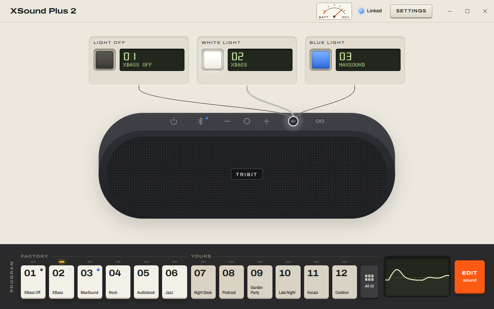
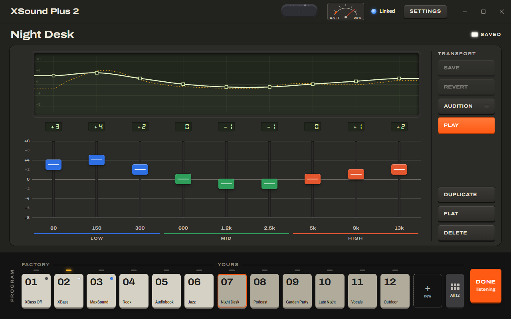

# Tribit Connect

Windows controls for the Tribit XSound Plus 2 speaker: a Win + W widget and a companion app with a
custom EQ editor. Modelled on [Bandwave](https://github.com/KanuTomer/Sound-Connect) (formerly Sound
Connect). An independent project, not affiliated with Tribit or Microsoft. MIT licensed.



## Features

- **Programs.** One list of everything the speaker can play: your own profiles and the six factory
  presets, in the order you choose. The first twelve are the keys on the program bar.
- **All programs.** Every program on one page, as records with their curves, with search. Drag to
  rearrange; right-click to edit, duplicate or delete.
- **Live EQ editor.** Nine bands (80 Hz to 13 kHz, ±8 dB), with faders and a display you can draw on.
  The speaker plays what you see, and every change is kept as you make it; there is nothing to save.
  **Compare** plays it as it was until you press it again, and **Undo** goes back. Changing a factory preset
  makes a copy you can edit.
- **The EQ button's lights.** The speaker's EQ button cycles through three lights (off, white, blue).
  Choose what each light plays, including your own curves; the speaker keeps them through a power cycle.
- **Widget and tray menu.** Battery, connection and your first six programs. The widget can also switch
  between your speakers.
- **Several speakers.** The **Speakers** page lists your paired Tribit speakers. The app remembers what
  each one last reported, so switching back shows its last-known settings.
- **Speaker settings.** Voice prompt beeps and auto shutdown.
- **Visualizer.** When this PC plays through the speaker, faint spectrum bars run behind the curve. It
  only hears this PC, not your phone.
- **Close to tray and Start with Windows**, light and dark appearance, and updates from this
  repository's releases.

Every change counts only once the speaker reports it back.

**Not supported**, because their commands are unknown: renaming the speaker, the shutdown countdown,
power off, factory reset and firmware updates. Use the Tribit app for those.



## Install

1. Download **`TribitConnect-Setup.exe`** from
   [Releases](https://github.com/KanuTomer/tribit-connect/releases) and run it.
2. Choose **Yes** when Windows asks for permission. Setup trusts the app's certificate, installs the
   Windows App Runtime from Microsoft if it is missing, then installs the app.
3. Pair the speaker in Windows Bluetooth settings. Open **Tribit Connect** from Start, or add
   **XSound Plus 2** from Win + W > Add widgets.

The app isn't signed by a recognised publisher yet, so SmartScreen may say "Windows protected your PC":
choose **More info**, then **Run anyway**. Uninstall it from Settings > Apps.

Requires Windows 11 x64 with Widgets (the Windows Web Experience Pack) and WebView2, both included
with Windows 11.

<details><summary>Manual install, without setup</summary>

1. Download `TribitConnect_<version>.msix` and `TribitConnect.Local.cer` from the same release.
2. In an administrator PowerShell in the download folder, run
   `Import-Certificate -FilePath TribitConnect.Local.cer -CertStoreLocation Cert:\LocalMachine\TrustedPeople`.
3. Install Microsoft.WindowsAppRuntime.2 2.5.1 or newer if it is missing, then open the `.msix` and
   select **Install**.
</details>

## Using it

**Speakers page.** The app opens on the speaker you used last. If that speaker is off, or you have two
or more and haven't picked one, it opens on the Speakers page instead, and goes to the speaker by itself
once Windows connects it. **‹ Speakers** in the title bar takes you there at any time, and the same key
(then showing the speaker's name) or Esc takes you back. Enter or a double-click on a speaker opens it.

**One controller at a time.** The speaker accepts a single control connection. While Tribit Connect holds
it, the Tribit app on your phone can't connect. Turn on **Let the phone app connect** in that speaker's
settings to free it shortly after you close the app and widget. If the phone app holds it instead,
Tribit Connect says **Controls busy** and offers **Try again**.

**Settings** follow the page:

| Where | What Settings holds |
|---|---|
| A speaker's page | that speaker's beeps, auto shutdown and Let the phone app connect |
| The Speakers page | the app's appearance, widget, window, updates and help (**App settings ›** in a speaker's Settings goes there) |

**The widget.** Windows shows a widget from an app outside the Microsoft Store only while Developer
Mode is on. Settings on the Speakers page shows whether it is, opens the right Windows page, and tells
you how to add the widget. Without the widget, the tray icon's menu has the same six buttons.

**Close to tray.** Closing the window keeps the app in the notification area. Click the icon to bring it
back, or right-click it for a menu: the speaker and its battery, the widget's six buttons (pick one to
play it without opening the app), **Open** and **Quit**. About 15 seconds after the window is hidden, the app lets
go of the speaker, so the phone app can connect while Tribit Connect sits in the tray.

**Start with Windows.** The app starts in the tray when you sign in, so the widget is ready. Windows
controls this switch: if it won't stay on, allow Tribit Connect in Windows Settings > Apps > Startup.

**Updates.** Once a day while **Check for updates** is on, or when you press **Check now**, the app asks
this repository's releases whether there is a newer version; nothing about you or your PC is sent.
**Update to x.y.z** downloads the new setup and checks that its SHA-256 matches and that it is signed by
this project's certificate. It then updates in place, keeping your profiles, and reopens the app.
Versions 0.6.0 and earlier can't update themselves: install the latest release once by hand.

## Your data

Profiles and settings are stored in `%LOCALAPPDATA%\Tribit Connect`:

| File | Contents |
|---|---|
| `profiles.json` | your profiles and the order of your programs |
| `profiles.bak` | your profiles as they were when the app last started, in case a save goes wrong |
| `profiles.bad-<time>.json` | a profiles file the app could not read, kept instead of being replaced |
| `state.json` | the speaker in use, the last values read from each speaker, and the app's settings |
| `theme` | light or dark, so the window opens in the right colour |
| `WebView2\` | the app window's browser cache (safe to delete) |
| `diagnostics.log` | only while Diagnostic log is on |

Uninstalling keeps this folder, so reinstalling or updating never loses your profiles. Windows doesn't
let packaged apps run anything on uninstall, so to remove your data use **Settings > Remove my data**
first, or delete the folder afterwards. Profiles from 0.3.0 and earlier move here on first launch.

## Develop

You need Windows x64 with Developer Mode, the Visual Studio 2022 C++ Build Tools with CMake, the Windows
SDK, and Node.js.

```powershell
./scripts/build.ps1 -Check            # fetch NuGet packages, build, run native tests
node --test app/tests/model.test.js    # frontend model tests
./scripts/package.ps1                  # signed MSIX, certificate and setup in out/
./scripts/package.ps1 -Register        # or register the build in place for development
```

`package.ps1` also writes `TribitConnect-Setup-<version>.exe` and its `.sha256`. A release must carry
both for the updater to offer it.

- **The app** is plain HTML, CSS and JavaScript in [app/](app/), hosted in WebView2 by
  [src/webview_host.hpp](src/webview_host.hpp). Open `app/index.html` in a browser to work on it against
  a simulated speaker; press the backtick key for the simulator's controls. Query options such as
  `?offline`, `?speakers=two` and `?uptodate` set up other states (see
  [app/js/mock-backend.js](app/js/mock-backend.js)).
- **The host** is [src/app.cpp](src/app.cpp): the speaker link ([src/controller.hpp](src/controller.hpp)),
  the widget provider, the tray, and the updater ([src/updates.hpp](src/updates.hpp)).
- **Widget** cards come from [src/widget_card.hpp](src/widget_card.hpp). `./scripts/mock.ps1` renders
  every card into `build/mock/index.html` with the Adaptive Cards renderer.
- **Design rules** are in [docs/DESIGN.md](docs/DESIGN.md).

## Protocol

The speaker is controlled over Bluetooth Classic RFCOMM channel 3 with a small checksummed frame format,
decoded from an Android HCI snoop capture of the Tribit app and confirmed from Windows. See
[PROTOCOL.md](PROTOCOL.md). The scrubbed capture is in [captures/](captures/), so you can check the
decoding or continue it.

Own a different Tribit speaker? [Add your speaker](https://tribit-connect-submit.vercel.app/) walks you
through recording a capture and sends it, cleaned in your browser.

## Probe

`tribit-probe` reads and writes the protocol from the command line. Close the Tribit app and Tribit
Connect first, because the speaker accepts one control connection at a time.

```powershell
./scripts/build.ps1 -Check
./build/bin/Release/tribit-probe.exe
```

By default it is read-only: it reads battery, firmware, current EQ, voice prompts, the EQ button's
lights and the unidentified status values, and prints JSON. It never scans, pairs or retries.

- `--trace` prints every frame sent and received.
- `--listen SECONDS` records frames the speaker sends by itself, for example when its buttons are pressed.
- `--verify-voice-prompts` flips TWS Pairing Beep once, confirms it, then restores it.
- `--preset 0-5` applies an EQ preset; `--custom-eq DB,...` applies nine custom bands;
  `--button-slot LIGHT=PRESET|custom:DB,...` sets what a light selects. These don't restore the previous
  value.
